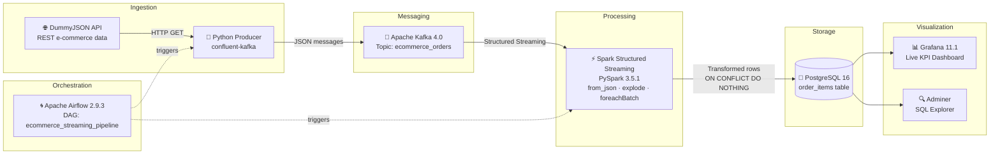

# 🛒 E-Commerce Real-Time Streaming Pipeline


A portfolio-ready **Big Data streaming pipeline** that simulates real-time e-commerce order processing — from REST API ingestion to live dashboards, fully containerized and orchestrated with Apache Airflow.

---

## 📐 Architecture



### Data Flow

| Layer | Component | Role |
|---|---|---|
| **Ingestion** | Python + DummyJSON API | Fetch configurable batches of e-commerce carts and publish them to Kafka |
| **Messaging** | Apache Kafka 4.0 (KRaft) | Decouple producer from consumer, buffer events |
| **Processing** | Spark Structured Streaming | Parse nested JSON, explode product arrays, deduplicate |
| **Storage** | PostgreSQL 16 | Persist transformed order items with Kafka metadata |
| **Visualization** | Grafana 11.1 | Live KPIs: orders, products, revenue, discounts |
| **Orchestration** | Apache Airflow 2.9.3 | Schedule and automate the end-to-end pipeline |
| **Infrastructure** | Podman Compose | Containerize all services locally |

---

## ✨ Features

- **Configurable ingestion** of multiple e-commerce carts from DummyJSON REST API
- **Event streaming** via Apache Kafka with KRaft mode (no ZooKeeper)
- **Spark Structured Streaming** with `from_json`, `explode`, and `foreachBatch` for nested JSON transformation
- **Idempotent writes** to PostgreSQL using `ON CONFLICT (kafka_partition, kafka_offset, product_id) DO NOTHING`
- **Checkpointed Spark runs** so scheduled executions can continue from the last processed Kafka offsets
- **Live Grafana dashboard** with auto-provisioned datasource and panels (orders, revenue, product breakdown)
- **Fully automated pipeline** orchestrated with Apache Airflow DAG
- **Environment-driven configuration** through `.env.example`
- **Executable validation** with unit tests and a PostgreSQL output validation script
- **Fully containerized** with Podman Compose (Kafka, PostgreSQL, Grafana, Airflow, Adminer)

---

## 🛠️ Tech Stack

| Category | Technology | Version |
|---|---|---|
| Language | Python | 3.11 |
| Event Streaming | Apache Kafka (KRaft) | 4.0.0 |
| Stream Processing | Apache Spark / PySpark | 3.5.1 |
| Orchestration | Apache Airflow | 2.9.3 |
| Database | PostgreSQL | 16 |
| Visualization | Grafana | 11.1.0 |
| DB Explorer | Adminer | 4 |
| Container Runtime | Podman Compose | — |
| Kafka Client | confluent-kafka | 2.6.1 |
| PostgreSQL Driver | psycopg2-binary | 2.9.9 |

---

## 📁 Project Structure

```
ecommerce-streaming-pipeline/
├── producer/
│   └── producer.py              # API → Kafka producer (confluent-kafka)
├── consumer/
│   └── consumer.py              # Educational Kafka consumer
├── spark/
│   └── streaming_job.py         # Spark Structured Streaming job
├── airflow/
│   ├── Dockerfile               # Custom Airflow image (Java + PySpark)
│   └── dags/
│       └── ecommerce_streaming_pipeline.py   # Airflow DAG
├── postgres/
│   └── init.sql                 # PostgreSQL schema (order_items table)
├── dashboard/
│   └── grafana/
│       ├── provisioning/
│       │   ├── datasources/     # Auto-configured PostgreSQL datasource
│       │   └── dashboards/      # Dashboard loader config
│       └── dashboards/
│           └── ecommerce-streaming.json      # Pre-built Grafana dashboard
├── docs/
│   └── ARCHITECTURE.md          # Detailed architecture documentation
├── docker-compose.yml           # Full stack: Kafka, Postgres, Grafana, Airflow
├── .env.example                 # Environment variables template
├── Makefile                     # Developer shortcuts
└── requirements.txt             # Python dependencies
```

---

## 🚀 Quick Start

### Prerequisites

- [Podman](https://podman.io/getting-started/installation) + `podman-compose`
- Python 3.11
- Git

### 1. Clone the repository

```bash
git clone https://github.com/semragse/End-to-End-Big-Data-streaming-project.git
cd End-to-End-Big-Data-streaming-project
```

### 2. Configure environment variables

```bash
cp .env.example .env
# Edit .env if needed (defaults work out of the box)
```

If your local network injects a self-signed HTTPS certificate and the producer fails with `CERTIFICATE_VERIFY_FAILED`, set `API_VERIFY_SSL=false` in `.env` for the local demo run. If DummyJSON is temporarily unavailable, set `ALLOW_SAMPLE_FALLBACK=true` to publish the included sample orders from `data/sample_orders.json`.

### 3. Build the Airflow image

```bash
podman build -t ecommerce-airflow:latest ./airflow
```

### 4. Start all services

```bash
podman-compose up -d
# Or: make up
```

### 5. Initialize Airflow

```bash
podman-compose up airflow-init
# Or: make airflow-init
```

### 6. Access the dashboards

| Service | URL | Credentials |
|---|---|---|
| Grafana | http://localhost:13000 | admin / admin |
| Airflow | http://localhost:18081 | admin / admin |
| Adminer | http://localhost:18080 | ecommerce_user / ecommerce_password |

### 7. Trigger the pipeline

Option A — via Airflow UI:
1. Open http://localhost:18081
2. Find `ecommerce_streaming_pipeline` DAG
3. Click the **▶ Trigger** button

Option B — via CLI:
```bash
make trigger
# or
podman exec ecommerce-airflow-webserver airflow dags trigger ecommerce_streaming_pipeline
```

### 8. Validate the result

```bash
make test      # Unit tests for producer API parsing
make validate  # Checks that PostgreSQL contains transformed order items
```

`make validate` expects the pipeline to have already written data to PostgreSQL.

---

## 🖥️ Services & Ports

| Service | Container Port | Host Port |
|---|---|---|
| Apache Kafka | 29092 | 19092 |
| PostgreSQL | 5432 | 5433 |
| Grafana | 3000 | 13000 |
| Airflow Webserver | 8080 | 18081 |
| Adminer | 8080 | 18080 |

---

## 🗃️ Database Schema

```sql
CREATE TABLE order_items (
    kafka_topic              VARCHAR(100)   NOT NULL,
    kafka_partition          INTEGER        NOT NULL,
    kafka_offset             BIGINT         NOT NULL,
    kafka_timestamp          TIMESTAMP      NOT NULL,
    order_id                 INTEGER        NOT NULL,
    user_id                  INTEGER        NOT NULL,
    order_total              NUMERIC(12,2)  NOT NULL,
    order_discounted_total   NUMERIC(12,2)  NOT NULL,
    total_products           INTEGER        NOT NULL,
    total_quantity           INTEGER        NOT NULL,
    product_id               INTEGER        NOT NULL,
    product_title            TEXT           NOT NULL,
    product_price            NUMERIC(12,2)  NOT NULL,
    product_quantity         INTEGER        NOT NULL,
    product_total            NUMERIC(12,2)  NOT NULL,
    product_discount_percentage NUMERIC(5,2) NOT NULL,
    product_discounted_total NUMERIC(12,2)  NOT NULL,
    inserted_at              TIMESTAMP      DEFAULT CURRENT_TIMESTAMP,
    PRIMARY KEY (kafka_partition, kafka_offset, product_id)
);
```

---

## 📊 Grafana Dashboard

The Grafana dashboard is **auto-provisioned** on startup with:

- **Orders table** — full list of ingested order items
- **Product totals** — revenue per product
- **Total order items** — KPI counter
- **Gross sales** — total revenue metric

Dashboard JSON: `dashboard/grafana/dashboards/ecommerce-streaming.json`


---

## 🌀 Airflow Run Evidence

The Airflow DAG runs the producer first, then launches the Spark transformation job.


---

## ⚙️ Airflow DAG

The `ecommerce_streaming_pipeline` DAG runs two tasks sequentially:

```
produce_order_to_kafka  ──►  transform_and_write_to_postgres
```

| Task | Description |
|---|---|
| `produce_order_to_kafka` | Calls DummyJSON API and publishes cart to Kafka topic `ecommerce_orders` |
| `transform_and_write_to_postgres` | Runs `spark-submit` to read Kafka, transform, and write to PostgreSQL |

Environment variables are injected by Airflow: `KAFKA_BOOTSTRAP_SERVERS=kafka:19092`, `POSTGRES_HOST=postgres`.

---

## 🔧 Makefile Commands

```bash
make up           # Start all services (podman-compose up -d)
make down         # Stop all services
make airflow-init # Initialize Airflow DB and create admin user
make trigger      # Trigger the Airflow DAG
make logs-spark   # Tail Spark task logs in Airflow
make psql         # Open PostgreSQL interactive shell
make count        # Count rows in order_items table
make test         # Run unit tests
make validate     # Validate PostgreSQL pipeline output
make clean        # Stop services and remove volumes
```

---

## 🔑 Key Design Decisions

**Why Kafka KRaft (no ZooKeeper)?**
Kafka 4.0 dropped ZooKeeper support. KRaft mode simplifies the setup — no separate ZooKeeper container needed.

**Why `trigger(availableNow=True)` in Spark?**
Instead of a continuous streaming job running forever, `availableNow` reads all available Kafka messages at trigger time and exits — ideal for batch-like scheduled runs via Airflow.

**Why Spark checkpointing?**
The checkpoint directory stores streaming progress metadata. On the next scheduled run, Spark can continue from the last committed Kafka offsets instead of treating every execution like a brand-new stream.
For the local container demo, checkpoints are written under `/tmp/spark-checkpoints` to avoid Windows-mounted volume permission issues.

**Why local Spark Kafka JARs?**
The Airflow DAG uses the JAR files in `jars/` instead of downloading Spark Kafka dependencies at runtime. This keeps the demo reliable on networks where Java cannot validate Maven HTTPS certificates.

**Why `ON CONFLICT DO NOTHING` in PostgreSQL?**
Kafka offsets are unique per partition. Using `(kafka_partition, kafka_offset, product_id)` as primary key makes writes naturally idempotent — safe to re-run the pipeline multiple times.

**Why Airflow `append_env=True`?**
`BashOperator` with `env=` replaces the entire environment, losing PATH. `append_env=True` merges our variables with the existing environment, ensuring `spark-submit` is found.

---

## 🤝 Contributing

1. Fork the repository
2. Create a feature branch (`git checkout -b feature/my-feature`)
3. Commit your changes (`git commit -m 'Add my feature'`)
4. Push to the branch (`git push origin feature/my-feature`)
5. Open a Pull Request

---

## 👤 Author

**Saad-Eddine GARMES**
- GitHub: [@semragse](https://github.com/semragse)
- LinkedIn: [linkedin.com/in/saad-eddine-garmes](https://www.linkedin.com/in/saad-garmes/)

---

## 📄 License

This project is licensed under the MIT License.
