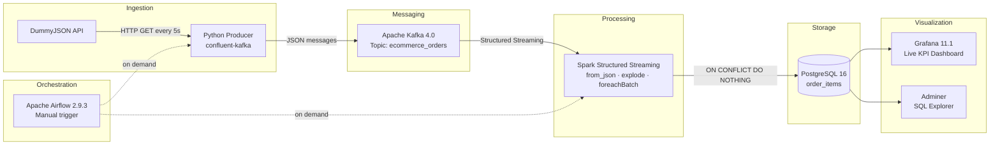

# E-Commerce Real-Time Streaming Pipeline


End-to-end streaming pipeline for real-time e-commerce order processing. A Python producer continuously fetches orders from a REST API and publishes them to Kafka. Spark Structured Streaming consumes those events, transforms the nested JSON, and writes to PostgreSQL. Grafana displays live KPIs as data arrives. Everything runs as long-lived Docker services — no manual triggering required.

---

## Architecture



| Layer | Component | Role |
|---|---|---|
| **Ingestion** | Python Producer | Continuously fetches carts from DummyJSON API and publishes to Kafka |
| **Messaging** | Apache Kafka 4.0 (KRaft) | Decouples producer from Spark, buffers events |
| **Processing** | Spark Structured Streaming | Parses nested JSON, explodes product arrays, writes to PostgreSQL |
| **Storage** | PostgreSQL 16 | Persists order items with idempotent writes |
| **Visualization** | Grafana 11.1 | Live KPIs: orders, revenue, product breakdown |
| **Orchestration** | Apache Airflow 2.9.3 | Manual pipeline triggering and monitoring |
| **Infrastructure** | Docker Compose | Containerizes all services |

---

## How It Works

The pipeline runs continuously without any manual intervention:

1. The **producer** container fetches 10 e-commerce carts from the DummyJSON API every 5 seconds and publishes each cart as a JSON message to the `ecommerce_orders` Kafka topic.
2. The **Spark** container reads from that topic every 10 seconds, parses the nested JSON (each cart contains multiple products), explodes the product array into individual rows, and writes them to PostgreSQL — skipping duplicates via `ON CONFLICT DO NOTHING`.
3. **Grafana** queries PostgreSQL and refreshes the dashboard in real time.
4. **Airflow** is available for manual ad-hoc runs and pipeline monitoring via its UI.

---

## Tech Stack

| Category | Technology | Version |
|---|---|---|
| Language | Python | 3.11 |
| Event Streaming | Apache Kafka (KRaft) | 4.0.0 |
| Stream Processing | Apache Spark / PySpark | 3.5.1 |
| Orchestration | Apache Airflow | 2.9.3 |
| Database | PostgreSQL | 16 |
| Visualization | Grafana | 11.1.0 |
| DB Explorer | Adminer | 4 |
| Container Runtime | Docker Compose | — |
| Kafka Client | confluent-kafka | 2.6.1 |
| PostgreSQL Driver | psycopg2-binary | 2.9.9 |

---

## Project Structure

```
ecommerce-streaming-pipeline/
├── producer/
│   ├── producer.py              # Continuous API → Kafka producer (infinite loop)
│   └── Dockerfile
├── spark/
│   ├── streaming_job.py         # Spark Structured Streaming job (continuous)
│   └── Dockerfile
├── airflow/
│   ├── Dockerfile               # Custom image (Java 17 + PySpark)
│   └── dags/
│       └── ecommerce_streaming_pipeline.py
├── postgres/
│   └── init.sql                 # Schema: order_items table
├── dashboard/
│   └── grafana/
│       ├── provisioning/        # Auto-configured datasource + loader
│       └── dashboards/
│           └── ecommerce-streaming.json
├── jars/                        # Spark Kafka connector JARs (bundled at build time)
├── docs/
│   └── ARCHITECTURE.md
├── docker-compose.yml
├── .env.example
└── Makefile
```

---

## Quick Start

### Prerequisites

- Docker + Docker Compose
- Git

### 1. Clone

```bash
git clone https://github.com/semragse/End-to-End-Big-Data-streaming-project.git
cd End-to-End-Big-Data-streaming-project
```

### 2. Configure

```bash
cp .env.example .env
```

### 3. Build images

```bash
docker compose build
```

### 4. Start the stack

```bash
docker compose up -d
```

The producer and Spark streaming job start automatically and run continuously.

### 5. Initialize Airflow (optional — for manual triggering)

```bash
docker compose up airflow-init
```

### 6. Access services

| Service | URL | Credentials |
|---|---|---|
| Grafana | http://localhost:13000 | admin / admin |
| Airflow | http://localhost:18081 | admin / admin |
| Adminer | http://localhost:18080 | ecommerce_user / ecommerce_password |

---

## Verifying the Pipeline

**Watch the producer send messages to Kafka:**
```bash
docker logs ecommerce-producer -f
```

**Watch Spark process batches:**
```bash
docker logs ecommerce-spark -f
```

**Count rows growing in PostgreSQL:**
```bash
docker exec ecommerce-postgres psql -U ecommerce_user -d ecommerce \
  -c "SELECT COUNT(*), MAX(inserted_at) FROM order_items;"
```
Run twice 10 seconds apart — the count must increase.

**See raw Kafka messages:**
```bash
docker exec ecommerce-kafka /opt/kafka/bin/kafka-console-consumer.sh \
  --bootstrap-server localhost:19092 \
  --topic ecommerce_orders \
  --from-beginning
```

---

## Services & Ports

| Service | Host Port |
|---|---|
| Apache Kafka | 19092 |
| PostgreSQL | 5433 |
| Grafana | 13000 |
| Airflow Webserver | 18081 |
| Adminer | 18080 |

---

## Database Schema

```sql
CREATE TABLE order_items (
    kafka_topic              VARCHAR(100)   NOT NULL,
    kafka_partition          INTEGER        NOT NULL,
    kafka_offset             BIGINT         NOT NULL,
    kafka_timestamp          TIMESTAMP      NOT NULL,
    order_id                 INTEGER        NOT NULL,
    user_id                  INTEGER        NOT NULL,
    order_total              NUMERIC(12,2)  NOT NULL,
    order_discounted_total   NUMERIC(12,2)  NOT NULL,
    total_products           INTEGER        NOT NULL,
    total_quantity           INTEGER        NOT NULL,
    product_id               INTEGER        NOT NULL,
    product_title            TEXT           NOT NULL,
    product_price            NUMERIC(12,2)  NOT NULL,
    product_quantity         INTEGER        NOT NULL,
    product_total            NUMERIC(12,2)  NOT NULL,
    product_discount_percentage NUMERIC(5,2) NOT NULL,
    product_discounted_total NUMERIC(12,2)  NOT NULL,
    inserted_at              TIMESTAMP      DEFAULT CURRENT_TIMESTAMP,
    PRIMARY KEY (kafka_partition, kafka_offset, product_id)
);
```

---

## Makefile Commands

```bash
make up              # Start all services
make down            # Stop all services
make build           # Build producer and spark images
make restart         # Restart full stack
make logs-producer   # Tail producer logs
make logs-spark      # Tail Spark logs
make psql            # Open PostgreSQL shell
make count           # Count rows in order_items
make query           # Show latest 10 order items
make kafka-topics    # List Kafka topics
make airflow-init    # Initialize Airflow DB
make trigger         # Manually trigger Airflow DAG
make clean           # Stop and remove all volumes
make status          # Show running containers
```

---

## Key Design Decisions

**Continuous streaming over batch triggers** — `trigger(processingTime="10 seconds")` keeps Spark running indefinitely, processing new messages as they arrive. The previous `availableNow` trigger exited after one pass and required Airflow to restart it.

**KRaft mode (no ZooKeeper)** — Kafka 4.0 dropped ZooKeeper. Single broker handles both broker and controller roles — simpler setup, one fewer container.

**Idempotent writes via composite primary key** — `(kafka_partition, kafka_offset, product_id)` as the primary key means restarting Spark or replaying Kafka offsets never creates duplicate rows.

**Local Spark Kafka JARs** — Kafka connector JARs are bundled into the Spark image at build time (`jars/`), avoiding Maven downloads at runtime.

**`restart: unless-stopped`** — Producer and Spark recover automatically from transient failures (API timeouts, Kafka restarts) without manual intervention.

**Airflow for manual control** — The pipeline runs independently of Airflow. Airflow is used to trigger ad-hoc runs, inspect task history, and demonstrate orchestration capability.

---

## Author

**Saad-Eddine GARMES**
- GitHub: [@semragse](https://github.com/semragse)
- LinkedIn: [linkedin.com/in/saad-garmes](https://www.linkedin.com/in/saad-garmes/)

---

## License

MIT License
